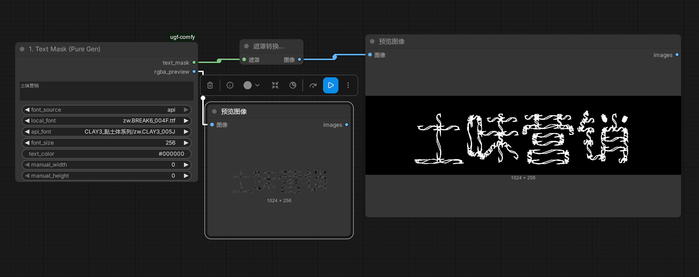
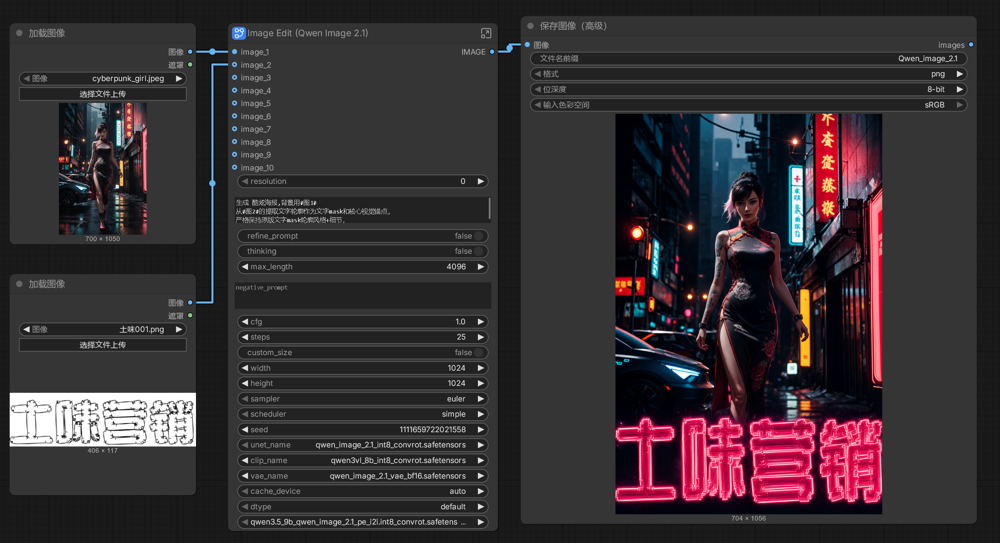
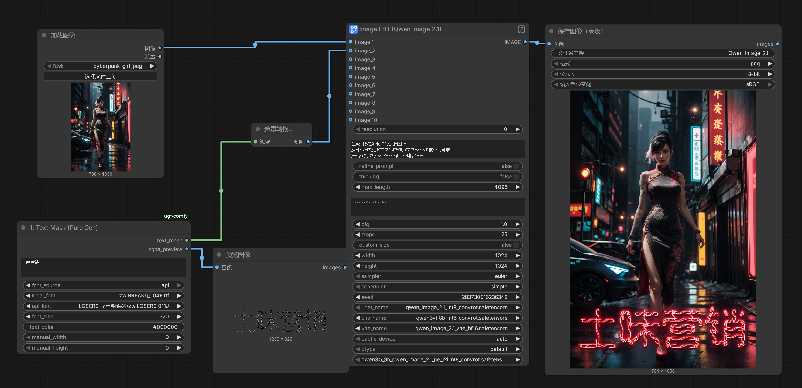
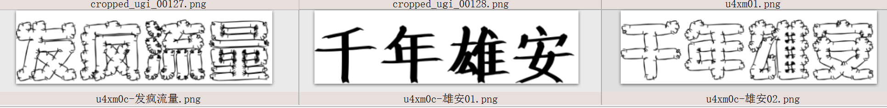
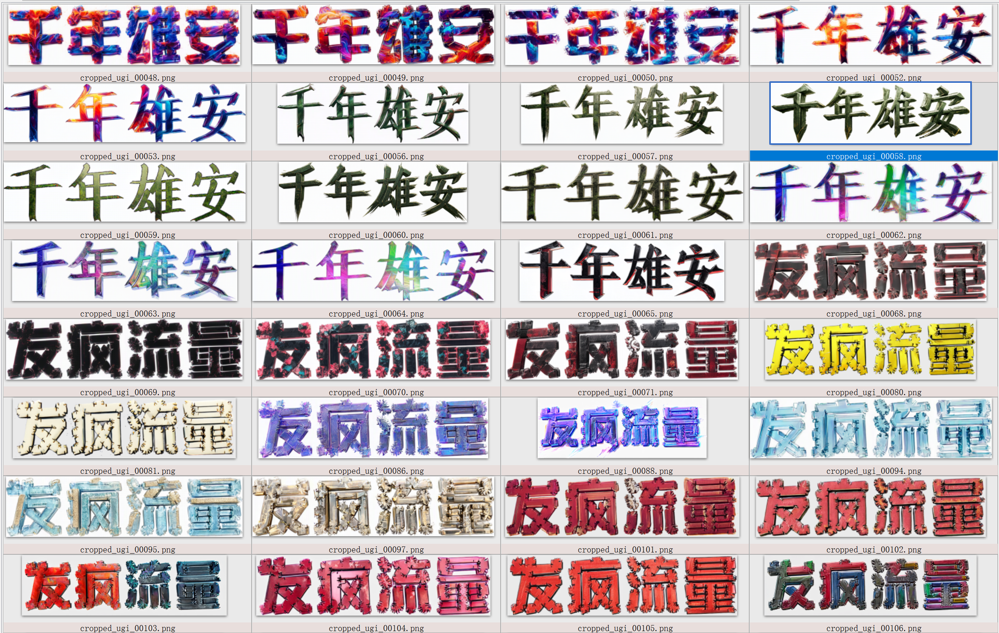
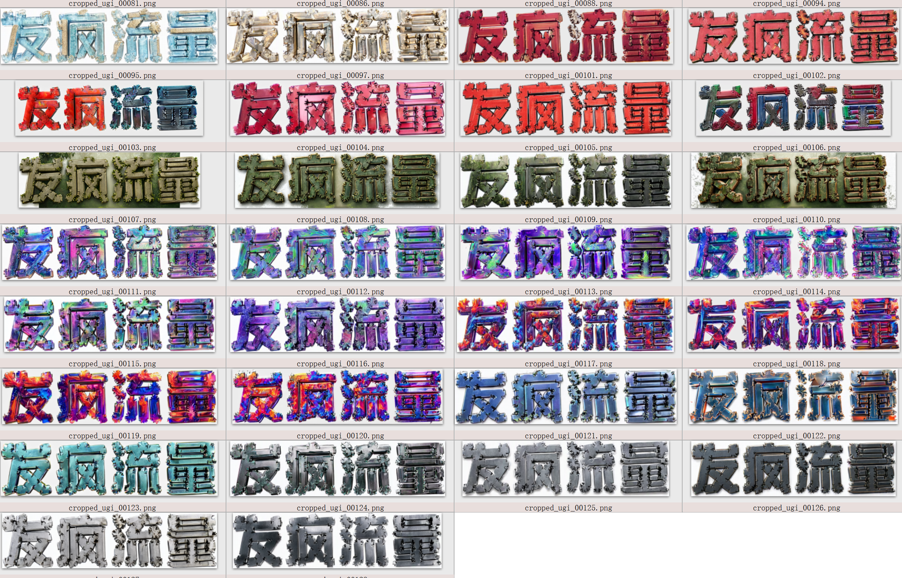

# ugi-comfy
ugi-comfy is a ComfyUI plugin for ugly AGI. 丑字AGI的ComfyUI插件。

# 📘 UGI-Comfy 插件使用文档 usage documentation
下载后，请解压，标准zip格式
After downloading, please unzip in standard zip format

下载地址Download link：

- modelscope魔塔：https://www.modelscope.cn/models/bd25vip/ugi-comfy
- github：https://github.com/m-f-vip/ugi-comfy

<video src="./doc/ugi26bar2.mp4" controls width="100%"></video>


zw-ps：
zw全网首发的汉字text-mask，包括专业术语，可以解决大模型99%汉字乱笔问题，是zw骨架网的基本应用之一。大家发paper的时候，记得原创是zw。
ZW's first Chinese character text mask on the entire network, including professional terminology, can solve 99% of the problem of messy Chinese characters in large models, and is one of the basic applications of ZW skeleton network. When posting papers, remember that the original work is ZW.


## 1. 简介Introduction
`ugi-comfy` 是丑字AGI的ComfyUI插件。
`Ugi cofy 'is a ComfyUI plugin for ugly AGI.

专为 ComfyUI 设计的广告/海报/短视频生成套件，可广泛用于AIGC图片生成，动态banner广告，ppt素材，电商海报，短视频片头，mv字幕，游戏素材等各种领域。
The advertising/poster/short video generation kit designed specifically for ComfyUI can be widely used in various fields such as AIGC image generation, dynamic banner advertising, PPT materials, e-commerce posters, short video opening titles, MV subtitles, game materials, etc.

它不需要加载任何扩散模型，就能直接通过本地 TTF 字体或远程 API 生成高精度的 32位透明通道文字 Mask，并将该 Mask 无缝接入下游的 SD/Flux 图像重绘，最后结合音频自动压制 MP4。
It does not require loading any diffusion model, and can directly generate high-precision 32-bit transparent channel text masks through local TTF fonts or remote APIs, seamlessly integrate the mask into downstream SD/Flux image redrawing, and finally automatically suppress MP4 with audio.


## 2. 目录结构
在 `ComfyUI/custom_nodes/` 下新建 `ugi-comfy`：
```text
ComfyUI/custom_nodes/ugi-comfy/
├── __init__.py
├── config.py
├── utils.py
├── nodes_mask.py      # 1# 核心文字Mask生成（本地/API/透明底/自动尺寸）
├── nodes_poster.py    # 2# 海报局部重绘
├── nodes_media.py     # 3# 视频音频合成
├── requirements.txt
├── fonts/             # 放入你的 .ttf 字体
└── doc/               # 配套资源，说明文档目录
```

案例图像编辑模型是：qwen image edit2.1，可自己更换。
视频模型，参考以上工作流，插入ugi相关节点即可。
更多，参考flux，qimage等图像，与视频集成工作流即可。

ugi_mask_bas-001.json，基础文本mask生成


ugi_q_image21-010.json，基础文本mask图像+图像编辑模型


ugi_q_image21-020.json，ugi直接生成+图像编辑模型



## 3. 节点说明
1. **模板加载器 (`UGF_StyleLoader`)**：读取 `styles/` 中的 PNG，并自动提取同名 `.txt` 或图片内置的提示词。
2. **文本 Mask (`UGF_TextMask`)**：
   - **智能尺寸**：默认 `font_size=256`，`height = font_size`，`width = 字数 * height`（可手动覆盖）。
   - **双引擎**：本地读取 TTF，或调用 API（自动处理 URL 编码、防乱码）。
   - **完美输出**：无论本地还是 API，最终都会强制抠除白底，输出透明底的 RGBA 预览图和纯白遮罩（Mask）。
3. **海报生成 (`UGF_PosterGenerator`)**：接收背景图和 Mask，调用 ComfyUI 原生 KSampler 进行局部重绘。
4. **视频音频合成 (`UGF_VideoAudioSaver`)**：接收帧序列和音频，调用 FFmpeg 压制带 AAC 音轨的 MP4。

---

## 合作联系


合作联系微信：15201112848（注明：ugi）

更多资料，请参看下面文档，以及公众号：智王ai

- [ugi-api演示面板：http://gradio.font.z-w.vip](http://gradio.font.z-w.vip)

- [zw多模态图灵测试： https://github.com/m-f-vip/zw26](https://github.com/m-f-vip/zw26)


- [3秒定生死，UGI成为品牌最锋利的视觉锤](./doc/3秒定生死，UGI成为品牌最锋利的视觉锤.pdf)

- [no情怀！年轻人，反内卷，大功德！丑字AGI](./doc/no情怀！年轻人，反内卷，大功德！丑字AGI.pdf)

- [从“千年雄安”到酷炫视频：我用UGI+豆包跑通了一条“发疯流水线”](./doc/从“千年雄安”到酷炫视频：我用UGI+豆包跑通了一条“发疯流水线”.pdf)

- [汉字笔画分割与“ai圣杯”](./doc/汉字笔画分割与“ai圣杯”.pdf)


## 更多demo

配合工作流，可以很轻松做到一键多图，自动去底等效果：

原始text-mask图：


一键多图效果，已经去底：




短视频片头，动态banner广告效果：
<video src="./doc/ugi26bar2.mp4" controls width="100%"></video>

<video src="./doc/雄安2_3M9yBMRG.mp4" controls width="100%"></video>

<video src="./doc/UGI丑字AGI2601.mp4" controls width="100%"></video>

<video src="./doc/大梁-XwETDsDc.mp4" controls width="100%"></video>


